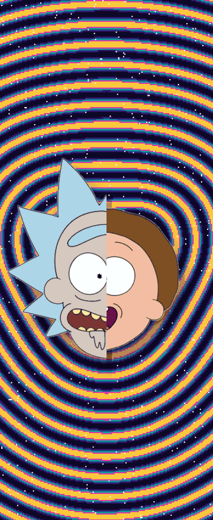

# Flip's Animation

An Android app for the Motorola Razr 60 Ultra that turns the fold gesture into a
living scene: a full-screen animated overlay driven by live hinge angle, plus
matching wallpapers on both the inner and cover displays — so the same artwork
greets you closed or open, locked or unlocked, mid-fold or at rest.

Package: `dev.franklyn.foldscenes` · minSdk 33 · targetSdk 36 · Kotlin + Jetpack Compose.

## What it does

**Hinge-driven overlay.** An `AccessibilityService` draws a `TYPE_ACCESSIBILITY_OVERLAY`
window on whichever display is lit (inner or cover), reading the device's
`TYPE_HINGE_ANGLE` sensor every frame. Each scene renders from a single continuous
progress value (`p = angle / 180`), so there is no snapping, no calibration step,
and no dependency on fold speed.

**Six scenes**, each tuned to stay legible behind the launcher's clock and icon
rows at both panel sizes:
- Sunrise
- Eclipse
- Mountains
- Spider-Verse
- Rick and Morty (crease-split face, splits cleanly on the hinge as the phone opens)
- Ronaldo (bicycle kick over purple Matrix rain)

<p align="center">
  
</p>

<sub>Real render output from the Rick and Morty scene at five fold progress
points (closed → open → closed), inner-display resolution. Not a mockup.</sub>

**Wallpapers that match the animation.** Picking a scene also sets:
- the inner home + lock wallpaper to the scene's fully-open frame
- the cover's two independent wallpaper slots (home and lock — Motorola splits
  these, most apps get this wrong) to the scene's fully-closed frame

so the overlay animates between two wallpapers that are already correct at rest,
instead of fading into a mismatched background.

**Per-app and camera exclusion.** A Settings screen lets you turn the animation
off for specific apps (e.g. don't play over a banking app or a video call), and
the system camera is suppressed automatically, detected via
`CameraManager.registerAvailabilityCallback` — not a hardcoded package allowlist,
so it also catches third-party camera apps.

By default, the animation does **not** play while any camera is active — this
is automatic and not user-togglable, shown locked in the Apps screen. For every
other app, the animation plays by default and only stops for apps the user
explicitly excludes in Settings → Apps; nothing is excluded unless the user
turns it off.

**System-synced theme.** Light/dark mode matches the phone's system setting on
first launch, with a manual override (System / Light / Dark) in Settings.

**Multi-device aware sizing.** Panel dimensions are read at runtime
(`DisplayManager` / `Display.getRealMetrics`), not hardcoded to one device, so
scene layouts hold up on other foldables with different inner/cover proportions.

## Why an accessibility service, not a live wallpaper

Tested and rejected on real hardware before settling on the current approach:

- Motorola's cover-screen wallpaper picker never lists third-party live
  wallpaper services — confirmed dead end.
- A permission-based `TYPE_APPLICATION_OVERLAY` (`SYSTEM_ALERT_WINDOW`) gets
  hard-capped to 80% opacity by Android whenever it sits over a secure/lock
  window and stays touch-transparent — confirmed on-device, not assumed.

`AccessibilityService` + `TYPE_ACCESSIBILITY_OVERLAY` is the only mechanism that
draws at full opacity on both displays, including over a locked cover screen.
The Play Store compliance angle (accessibility APIs are policy-sensitive) is
handled with a prominent in-app disclosure and consent screen before the
service does anything, not by avoiding the API.

## Cover wallpaper: how it actually works

Motorola's own `EDIT_SECONDARY_WALLPAPER` editor does **not** write
`WallpaperManager` — it only crops an image to a local file and hands back a
URI, leaving the caller to apply it. This app skips that editor entirely and
writes both cover slots directly:

```kotlin
WallpaperManager.getInstance(ctx).setBitmap(bitmap, null, false, which)
// which = 16 (cover lock) first, then 4 (cover home)
```

No extra permission beyond the ordinary `SET_WALLPAPER` the app already holds.
Full writeup, including the live probe that confirmed it:
[`docs/research/2026-10-26-cover-wallpaper-mechanism.md`](docs/research/2026-10-26-cover-wallpaper-mechanism.md).

## Status

Built and verified on a real Razr 60 Ultra. Device-specific behavior (cover
wallpaper slots, hinge sensor quirks, accessibility-service caveats) is
documented in-repo as it was discovered, not assumed from Android docs alone.

Scopes not yet built: Play Store submission (needs original art to replace the
placeholder copyrighted scenes — Rick and Morty, Spider-Verse, Ronaldo — plus a
`QUERY_ALL_PACKAGES` use-case declaration for the per-app exclusion picker).
